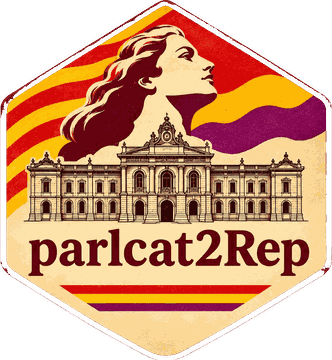

# parlcat2Rep 

> **Development version.** The citation, the licence of the data and the
> maintainer details are drafts.

**parlcat2Rep** gives R access to *Voices of the Republic*, the speech corpus
of the Parliament of Catalonia during the Spanish Second Republic, from its
constitution in December 1932 to its last session in October 1938:

- **32,666 speeches** in **259 sessions**, **4.57 million words**;
- for every speech, the person who delivers it, their **party on the date**
  and the **office** they hold;
- the reference tables used to build these assignments (MPs, parties,
  governments, offices, party changes) and the record of the human review.

The text comes from the *Diari de Sessions del Parlament de Catalunya*,
published by the [Parliament of Catalonia](https://www.parlament.cat/web/documentacio/recursos-documentals/diari-republica/index.html),
transcribed with OCR and split into speeches.

## Installation

```r
# install.packages("pak")
pak::pak("hunsao/parlcat2Rep")
```

Speech metadata and reference tables are bundled with the package. The text
of the speeches (about 6 MB) is downloaded once and cached:

```r
library(parlcat2Rep)
parl_download()
```

## Usage

```r
# Speeches by the Lliga in 1934, without the text
parl_speeches(year = 1934, party = "LR", text = FALSE)

# Who governed, and with which parties, on a given date
parl_government_on("1934-01-05")

# Search the text (accent and case insensitive)
parl_search("rabassaires", include_chair = FALSE)
parl_kwic("Estatut", window = 8, year = 1932)

# Frequency of a term over time, by government and opposition
parl_trend("ordre públic", group = "side") |>
  parl_plot_trend()

# Text-analysis formats
corp <- parl_as_corpus(parl_speeches(year = 1936))   # quanteda
toks <- parl_tidy(parl_speeches(year = 1938))        # tidytext
```

## Documentation

| | English | Català |
|---|---|---|
| Introduction | [Introduction](https://hunsao.github.io/parlcat2Rep/articles/en/introduction.html) | [Introducció](https://hunsao.github.io/parlcat2Rep/articles/ca/introduccio.html) |
| Functions and data | [Guide to functions and data](https://hunsao.github.io/parlcat2Rep/articles/en/functions.html) | [Guia de funcions i dades](https://hunsao.github.io/parlcat2Rep/articles/ca/funcions.html) |
| Methodology | [Methodology, sources and warnings](https://hunsao.github.io/parlcat2Rep/articles/en/methodology.html) | [Metodologia, fonts i advertiments](https://hunsao.github.io/parlcat2Rep/articles/ca/metodologia.html) |

Before counting, read the warnings in the methodology article: use
`party_data` (party on the date), not `party` (1932 ticket); decide whether to
include the speeches made while chairing the session; and remember that
readings by the secretary and anonymous headings are excluded by default.

## Problems and suggestions

Please report errors in the data or the package, or suggest improvements, at
<https://github.com/hunsao/parlcat2Rep/issues>.

## How to cite

Draft citation (not final):

> Rodon, Toni, and David Carbonell. 2026. *Voices of the Republic: A Speech
> Corpus of the Parliament of Catalonia (1932–1938)*. Version 1.0. VEARLYDEM
> Project, Universitat Pompeu Fabra. DOI pending.

In R: `citation("parlcat2Rep")`.

## Licenses

- Code: MIT.
- Data: Creative Commons Attribution 4.0 (CC BY 4.0), draft.

## Acknowledgments

Part of the VEARLYDEM project (*Voting in Early Democracies: The Case of the
Spanish Second Republic*), Universitat Pompeu Fabra, funded by the Agencia
Estatal de Investigación (PID2023-152743NB-I00).
